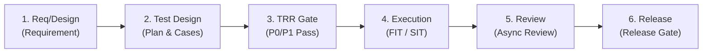

# OpenAN Integration Testing Process and Framework

> *Version: v0.1 (Draft)*  
> *Maintained by: OpenAN Integration Testing Working Group*  
> *Language: English*

---

## Contents

---

## 1. Purpose and Scope

**1.1 Purpose**

- Standardize the definition, process, and quality gates of integration testing within the OpenAN community, ensuring all working groups and community partners deliver integrable code under a unified set of rules.
- Reduce integration risks before release and avoid the situation where "every module passed unit tests, but they fail when integrated."
- Provide contributors with clear guidance on "how to write integration tests for OpenAN."

**1.2 Scope**

- Applies to all OpenAN community code repositories and the corresponding integration test repository.
- Applies to all integration testing activities before a community release, including Feature Integration Testing (FIT), System Integration Testing (SIT), and specialized testing.
- Does not replace unit testing (UT) or static code analysis; unit testing is governed by each working group within their module repositories.

**1.3 Audience**

- Contributors, working group test owners, reviewers, Integration Testing Working Group members, maintainers, release managers.

---

## 2. Terminology

| Term | Definition |
| --- | --- |
| Feature | A functional unit in the OpenAN community, organized by working group, corresponding to one or more code repositories. |
| Working Group (WG) | A collaborative unit in the OpenAN community organized by responsibility, such as the Integration Testing WG, Infra WG. |
| Feature Integration Test (FIT) | Within a single feature, verifies that multiple modules/services can integrate correctly in a real environment and fulfill requirements. |
| System Integration Test (SIT) | At the OpenAN distribution level, verifies stability, availability, and compatibility of multiple features under typical scenarios. |
| Test Readiness Review (TRR) | The acceptance checkpoint after feature development is complete and before entering FIT; entry criteria is 100% pass rate of P0/P1 test cases. |
| Quality Gate | A set of automated checks that must all pass, including test pass rate, coverage, license, sensitive information, etc. |
| RC (Release Candidate) | A joint debugging candidate version released regularly by Release Management for community partners to try out and verify. |
| Long-duration Stability Test | Running continuously for 7×24 hours to verify system stability under prolonged load. |
| Integration Testing WG | The working group responsible for overall quality assurance and test system maintenance. |
| Infra WG | The working group responsible for CI engineering and gate pipeline maintenance. |
| P0/P1/P2/P3 | Priority levels for test cases and defects. For cases: P0 blocks installation or the core closed-loop path, P1 impairs major functionality, P2 covers general scenarios (pass-rate gates in §8). For defects: severity levels with response and fix timelines per §9.1. |

---

## 3. Roles and Responsibilities

| Role | Responsibilities |
| --- | --- |
| Contributor | Submits code and accompanying integration test cases; ensures cases are repeatable and automatically executable; responds to review feedback. |
| Reviewer | Reviews test plans, test code, and test reports; checks compliance with this standard; confirms quality data. |
| WG Test Owner | One per working group; oversees the test plan and progress of the WG, reports to the Integration Testing WG; not required to execute tests personally. |
| Integration Testing WG | Maintains this standard, templates, and test cases; provides automation test case templates and generation/execution skills; organizes test plan and report reviews; executes SIT and specialized tests; aggregates quality data. |
| Infra WG | Maintains CI pipelines, gate checks, and daily builds; ensures test environments are available and reusable. |
| Maintainer | Holds ultimate responsibility for merged code and accompanying tests; checks gate results; approves feature TRR. |
| TSC | Determines RC release cadence and release review; decides Go / No-Go. |

**3.1 Test Owner Requirements**

- Must cover at least one full release cycle;
- Can come from the WG or the Integration Testing WG;
- Must have a global understanding of test work items within the WG.

---

## 4. Overall Integration Testing Process

### 4.1 Process Overview




### 4.2 Stage Descriptions

**Stage 1: Requirements and Design**

- Test design may begin only after the feature proposal has passed TSC review.
- Output: Feature test plan (including FIT scope, SIT scope, required environments, data, and schedule).

**Stage 2: Test Design**

- Write the test plan following the template, with test cases attached in CSV/table format;
- Cases must be tagged with priority (P0/P1/P2), environment, and dependencies;
- The test plan is submitted as a PR to the `integration-test` repository under the corresponding version directory, reviewed by the Integration Testing WG via PR review, and merged upon approval.

**Stage 3: Test Readiness Review (TRR)**

- Trigger conditions: feature code development complete, module-level UT/DT all passed, image built;
- Entry criteria: automated FIT with **100% pass rate for P0/P1 cases**; P2 case pass rate ≥ 80%;
- Decision maker: Feature WG Maintainer;
- Upon approval, the feature formally enters the "Feature Integration Testing" stage.

**Stage 4: Test Execution**

- Feature Integration Testing (FIT): run all FIT cases for the feature in a real environment;
- System Integration Testing (SIT): SIT executed by the Integration Testing WG on RC versions, covering multi-feature combination scenarios;
- Execution results must be automatically collected: case pass rate, failed case list, trace/log/screenshots, performance metrics.

**Stage 5: Report Review**

- The Feature WG Test Maintainer writes the feature test report (per template);
- The Integration Testing WG organizes a review meeting (online/offline), focusing on: whether case coverage targets are met, whether remaining issues have workarounds, and whether performance meets baselines.

**Stage 6: Archive and Release**

- Test plans, test reports, and test code are all archived in the `integration-test` repository;
- The Release Manager decides whether the version proceeds to official release based on SIT results and the remaining issue list.

### 4.3 Test Timeline (per Release Cycle)

> Concrete dates follow each release plan (see the [OpenAN 26.12 Release Plan](https://lf-networking.atlassian.net/wiki/spaces/OpenAN/pages/1187905545/OpenAN+26.12)); deliverable templates are maintained in the `integration-test` repository under `docs/templates/`.

#### 4.3.1 Handover (M4: Test Design and Review)

**Entry conditions**: The M4 feature-freeze window opens; the feature requirement baseline is frozen.

**Workflow:**

1. The feature WG submits a handover issue in the `integration-test` repository (linked to requirements and feature scope), using the `.github/ISSUE_TEMPLATE/feature-test-tracking.md` template;
2. Submits the test plan (per the [test plan template](https://github.com/project-openan/integration-test/blob/main/docs/templates/test-plan-template.md)) and the case table (per the [test case table template](https://github.com/project-openan/integration-test/blob/main/docs/templates/testcases-template.csv)) via PR (using `.github/PULL_REQUEST_TEMPLATE.md`), and merges the FIT automated test cases;
3. The Integration Testing WG organizes the review of the plan, cases and automation code;
4. Upon approval the handover is complete.

**Feature WG**: delivers the test plan, test case table and FIT automated test cases (merged into `e2e/<feature>/`).
**Integration Testing WG**: organizes the review; delivers review comments and the TRR conclusion.
**Acceptance**: test plan approved; cases conform to the standards (P0/P1 100% automated, requirement links filled); automated cases independently repeatable.

#### 4.3.2 RC-0 (Full Testing & Requirement Acceptance)

**Entry conditions**: Feature development complete and full handover done; the RC-0 version image package built.

**Workflow:**

1. The feature WG test owner executes the full FIT self-test and produces the self-test report;
2. The Integration Testing WG deploys the RC-0 image package and verifies deployment;
3. Runs the full FIT/SIT regression and starts specialized testing (performance, 7×24h stability, security, compatibility, A2A-T protocol, etc.);
4. Coverage and pass-rate requirements are verified against the test report, completing requirement acceptance;
5. The feature WG fixes P0/P1 defects or provides workarounds; the Integration Testing WG publishes the RC-0 test report.

**Feature WG**: delivers the FIT self-test report and defect closure records.
**Integration Testing WG**: runs the regression and specialized testing; delivers the RC-0 test report and the requirement acceptance conclusion.
**Acceptance**: pass rates meet Framework §8.2 (P0/P1 = 100%, overall ≥ 95%); coverage meets Framework §8.4 (requirement coverage 100%, API coverage ≥ 80%); defect handling within Framework §9.1 timelines; RC-0 test report published.

#### 4.3.3 RC-1 (Pre-Release Testing)

**Entry conditions**: RC-0 issues fixed; the RC-1 version image package built.

**Workflow:**

1. The Integration Testing WG deploys the RC-1 image package;
2. Runs the full FIT/SIT regression and wraps up specialized testing (stability conclusions, etc.);
3. Publishes the RC-1 test report and aggregates quality data as release-decision input;
4. TSC release review (Go/No-Go).

**Feature WG**: closes residual defects and accepts risks; delivers the residual issue list.
**Integration Testing WG**: delivers the RC-1 test report and quality data summary with the release recommendation.
**Acceptance**: Framework §8.3 release entry met (SIT pass rate 100% without skips, stability run without P0/P1 failures, install/upgrade/rollback passed, all P0 defects closed); quality data summary complete.

---

## 5. Test Layers and Scope

### 5.1 Layered Model

| Layer | Executor | Environment | Focus | Case Form |
| --- | --- | --- | --- | --- |
| Unit Test (UT) | Developer | IDE / Mock | Correctness of individual functions/classes | `<pkg>_test.go` / `test_*.py` in module repo |
| Developer Test (DT) | Developer | Local cluster | Module external interface contracts | Smoke e2e cases in module repo |
| **Feature Integration Test (FIT)** | Feature WG | **Real environment** | Integration correctness of multiple modules/services within the feature | Feature directory in `integration-test` repo |
| **System Integration Test (SIT)** | Integration Testing WG | **Real environment + typical scenarios** | Overall stability, availability, compatibility of the distribution | `system-integration/` in `integration-test` repo |
| Specialized Testing | Integration Testing WG | Varies by specialty | Performance, security, compatibility, long-duration stability, documentation, conformance | Specialty directories |

### 5.2 Boundaries of Integration Testing

**Included in Integration Testing (FIT/SIT/Specialized Testing)**

- Cross-module API calls, cross-service data flows, event trigger chains;
- Installation/upgrade/rollback paths;
- Multi-feature combination usage (e.g., registry + orchestrate + execute);
- Validating end-user critical paths on a real Kubernetes cluster or virtual machine;
- Specialized testing: performance, stress, stability, reliability, security, compatibility, A2A-T protocol, etc. (executed by the Integration Testing WG; categories defined in Section 10).

**Not Included in Integration Testing (do not do these at the integration layer)**

- Boundary conditions of individual functions (should be covered in UT);
- Pure UI layout and styling (belongs to frontend manual/UI automation, not covered by this standard).

---

## 6. Test Case Standards

### 6.1 Case ID and Naming

- Case ID format: `FIT-<feature>-<topic>-<number>` (e.g., `FIT-orchestration-workflow-001`); SIT cases use `SIT-<scenario>-<number>`;
- Test descriptions in English, format: `<case-id> - Case Description`;
- **Test file naming**: `test_<topic>.py`, where topic is a functional scenario under the feature, using lowercase words separated by underscores (e.g., `test_workflow.py`, `test_agent.py`);
- **Test function naming**: `test_<action>_<expected_result>`, clearly expressing the action and expected result (e.g., `test_create_workflow_success`, `test_delete_agent_not_found`);
- **Optional class grouping**: When a topic has many cases, use `Test<Topic>API` class grouping (e.g., `TestWorkflowAPI`); methods within the class still start with `test_`;
- **Playwright test files**: `test-<scenario>.spec.ts`.

### 6.2 Directory Structure

```
integration-test/
├── e2e/                              # Backend integration tests (pytest)
│   ├── framework/                    # Shared: K8s client, env loading, utilities
│   ├── <feature>/                    # Directory per feature
│   │   ├── test_<feature>_api.py
│   │   ├── test_<topic>.py
│   │   ├── system-integration/       # System-level integration cases for this feature
│   │   │   └── test_<scenario>.py
│   │   └── utils/  static/
│   └── .env.template
├── e2e-frontend/                     # Frontend UI automation (optional)
├── docs/                             # Test plans, reports, and templates archive
│   ├── templates/                    # Test plan / case table / test report templates
│   ├── plans/                        # Test plans by version
│   └── reports/                      # Test reports by version
└── README.md
```

### 6.3 Case Writing Requirements

- Every case must include: preconditions, steps, assertions, and cleanup actions;
- Assertions must be explicit; logging without assertion is prohibited;
- Cases must be independently repeatable; relying on execution order from other cases is prohibited (if ordering is required, explicitly declare with `Ordered` / `test.describe.serial`);
- Multiple closely related cases may be merged into one test function to reduce duplicate context creation;
- Using `sleep` for synchronization is prohibited; use framework-provided wait/retry mechanisms (Playwright auto-wait, `eventually`, etc.);
- On failure, preserve the scene: trace, screenshots, relevant Pod logs, K8s events.

### 6.4 Labels / Tags

Every case must carry at least the following label dimensions:

| Dimension | Examples | Description |
| --- | --- | --- |
| feature | `registry-center`, `orchestration-center` | Module identifier |
| environment | `with-workload-cluster`, `online`, `offline` | CI environment filtering |
| components | `registry-center`, `openan-portal` | Required components |
| priority | `P0`, `P1`, `P2` | Case priority |
| skip | `skip-temporarily` | Temporary skip; must reference an issue link |
| **execution** | `smoke`, `full`, `slow` | PR CI runs `smoke`, Daily runs `full` |

### 6.5 Data Preparation and Cleanup

- Test data is provided via fixtures; choose function/class/module/session scope as needed;
- Every case must clean up in teardown: delete created namespaces, CRs, Pods, PVs, configurations;
- Sharing mutable state across cases is strictly prohibited; session-level fixtures are only for read-only configuration (e.g., llm config, login state).

### 6.6 Configuration and Secrets

- All external dependencies (cluster addresses, credentials, SSH, image registries) are injected via environment variables;
- Only `.env.template` is kept in the repository; **committing **`.env`** or any real credentials is strictly prohibited**;
- During code review, check for hardcoded IPs / passwords / tokens; reject merge if found.

---

## 7. Automation Framework and Toolchain Recommendations

### 7.1 Recommended Stack

| Purpose | Primary | Alternative | Notes |
| --- | --- | --- | --- |
| Backend integration testing | pytest (Python) | - | Same language as OpenAN main code; reuse clients and types |
| Frontend UI testing | Playwright (TypeScript) | pytest + Playwright (Python) | Playwright auto-wait + Trace capabilities are mature |
| K8s resource management | client-go / kubernetes-client python | - | Already encapsulated in framework |
| Cluster lifecycle | kind / k3s (local), community lab (real cluster) | - | FIT runs on real clusters |
| Reporting | JUnit XML + Allure | - | CI aggregation and display |

### 7.2 CI Trigger Strategy

- **PR trigger**: run only FIT cases under affected feature directories, with label `--label-filter="!<skip-temporarily>"`;
- **Daily build trigger**: full FIT + smoke SIT;
- **RC version trigger**: full FIT + full SIT + start long-duration stability test;
- **Pre-release trigger**: rerun all P0/P1 + all SIT on RC as input to release review.

### 7.3 Gate Pipeline

The PR gate pipeline maintained by the Infra WG must include at least:

1. License / DCO check;
2. Code style and static analysis;
3. Interface change check (compatibility);
4. Sensitive information scan (secrets, internal IPs);
5. Smoke FIT cases under the affected feature directory.

After passing the gate, CI can merge and publish the daily build.

---

## 8. Entry and Exit Criteria (Quality Gates)

### 8.1 TRR (FIT Entry)

- P0 case pass rate = 100%;
- P1 case pass rate = 100%;
- P2 case pass rate ≥ 80%;
- Module-level UT coverage does not decrease (compared to previous version);
- Image is buildable and deployable.

### 8.2 FIT Exit

- Overall FIT case pass rate ≥ 95%;
- Failed cases have archived issues and are labeled `skip-temporarily`;
- Performance is not lower than the previous version baseline (key interface P99 latency, resource usage);
- Test report is reviewed and approved by the Integration Testing WG.

### 8.3 SIT Exit / Release Entry

- Overall SIT case pass rate = 100% (no skips allowed);
- 7×24h continuous stability run on RC with no P0/P1 failures;
- Installation, upgrade, and rollback paths all pass;
- No open P0 defects; P1 defects have clear workarounds and fix plans;
- Compatibility matrix (OS × hardware × dependency versions) passes.

### 8.4 Coverage Requirements

- Module repository UT line coverage ≥ 70% (core modules ≥ 80%);
- Integration test API coverage ≥ 80% (counted by OpenAPI paths).

---

## 9. Defect Management and Regression

### 9.1 Defect Severity

| Severity | Definition | Fix Timeline |
| --- | --- | --- |
| P0 | Blocker: installation failure, data loss, core functionality unavailable | Must respond within 24h; must fix in current release |
| P1 | Critical: major functionality impaired, but temporary workaround exists | Fix within 3 business days |
| P2 | Major: minor functionality issues | Fix in next release |
| P3 | Minor: UI, copy, experience | Schedule as needed |

### 9.2 Defect Process

1. Failed cases automatically open an issue with trace/log/screenshots/cluster info attached;
2. Defect ownership is confirmed by the WG test owner + Maintainer;
3. After fix, regression cases must be added and FIT rerun;
4. Before RC release, all P0/P1 defects must be closed or have clear workarounds.

### 9.3 Regression Strategy

- Every fix PR must rerun all FIT cases for that feature;
- Every RC version must rerun all P0/P1 cases;
- Full regression must be performed once before official release.

---

## 10. Non-Functional Testing

| Category | Examples of Test Items | Key Metrics / Scenarios |
| --- | --- | --- |
| **Performance** | API response time, workflow execution latency, negotiation throughput, agent registration/discovery | P95/P99 latency, TPS/QPS, resource utilization |
| **Stress** | Concurrent workflows, massive agent scale, high-concurrency negotiation, message backlog recovery | Breaking point, degradation pattern, recovery time |
| **Stability** | Basic stability (7×24h), load stability (7×24h), extended stability (30 days) | Memory leak, performance degradation, restart frequency |
| **Reliability** | Fault injection, network partition, dependency failure, disk pressure | Auto-recovery, graceful degradation, state consistency |
| **Security** | TLS/mTLS verification, JWS signature validation, permission isolation, API security scan | OWASP Top 10 compliance |
| **Compatibility** | Kubernetes versions, OS compatibility, browser compatibility, database backends, dependency versions | Supported range per `openan-installation`: K8s v1.33+ / Helm 3.10+; DB backends: file/SQLite/PostgreSQL/MySQL/GaussDB; certified matrix (e.g., K8s v1.33-1.35, Ubuntu/CentOS/openEuler, Chrome/Firefox/Edge/Safari) is defined in the release test plan |
| **A2A-T Protocol** | Protocol conformance (message schemas, state machines, dual-transport equivalence), prompt contract compliance (per the prompt templates spec), interoperability (cross-language SDKs, A2A base protocol interop), negotiation state consistency, protocol version compatibility, large payload handling, concurrent negotiation conflict | Client/server state alignment, v1.0/v1.1 interoperability |

**Note**: Detailed performance benchmarks and thresholds are defined in separate test plans, not in this general framework.

## 11. Contribution Guidelines

### 11.1 Submitting Integration Test Cases

1. **Sign the CLA** (required before first contribution);
2. **Fork & Branch**: from `integration-test` `main`, create `<feature>/<your-name>-<short-desc>`;
3. **Local Development**: follow Sections 6 and 7 of this standard; verify locally on a real or temporary cluster;
4. **Self-test**: `pytest e2e/<feature>/ -m "not slow"` passes;
5. **Submit PR**: PR description includes: feature name, case count, local run results, whether new environment variables are needed;
6. **CI Check**: pass gates (License, static analysis, smoke FIT);
7. **Code Review**: dual review by WG Reviewer + Integration Testing WG;
8. **Merge**: Maintainer approves and merges; cases enter daily build.

### 11.2 Review Standards

- Cases comply with this standard (naming, tags, assertions, cleanup);
- Include necessary negative/exception cases;
- No hardcoding, sleep, or implicit order dependencies;
- Failure scene information is sufficient (trace/log/screenshots);
- Environment variables are added to `.env.template` and documented in README.

### 11.3 Test Plans and Reports

- Test Plan: use template, attach case CSV, PR to `integration-test` repo `docs/plans/<version>/` directory;
- Test Report: use template, include execution data, remaining issues, performance data, PR to `integration-test` repo `docs/reports/<version>/` directory;
- Version directories are named `<YY>-<season>` (e.g., `26-winter`); the same identifier is used as the milestone in test plans, case tables, and case labels;
- Both are reviewed by the Integration Testing WG and then archived.

---

## 12. Test Strategy by Repository

| Repository | Language | Type | Test Strategy | Framework | Archive Location |
| --- | --- | --- | --- | --- | --- |
| `a2a-t-sdk-python` | Python | SDK | UT | pytest | In-repo |
| `a2a-t-sdk-java` | Java | SDK | UT | JUnit 5 | In-repo |
| `workflow-engine-sdk-java` | Java | SDK | UT | JUnit 5 | In-repo |
| `workflow-engine-sdk-python` | Python | SDK | UT | pytest | In-repo |
| `a2a-t-prompt-templates-spec` | - | Spec | Template spec conformance review | Manual review | In-repo |
| `orchestration-center` | Python + Node.js | Core Service | UT + FIT | pytest + requests/httpx | `integration-test` |
| `registry-center` | Python | Core Service | UT + FIT | pytest + requests/httpx | `integration-test` |
| `openan-portal` | JavaScript | Portal | UT + UI Testing | Jest / Vitest + Playwright | `integration-test/e2e-frontend/` |
| `openan-installation` | Shell + Helm | Deployment | Deployment Testing | pytest + kubernetes-client | `integration-test/e2e/installation/` |
| `openan-demo` | JavaScript | Demo | No independent testing | - | - |
| `project-openan.github.io` | HTML | Website | No independent testing | - | - |

**Notes:**

- **SIT**: Executed by the Integration Testing WG on RC versions, covering multi-service combination scenarios

---

> *This standard draft is maintained by the OpenAN Integration Testing Working Group. Community members are welcome to submit improvements via PR.*
